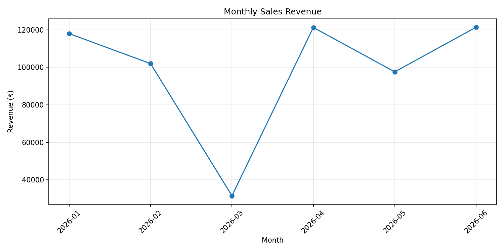
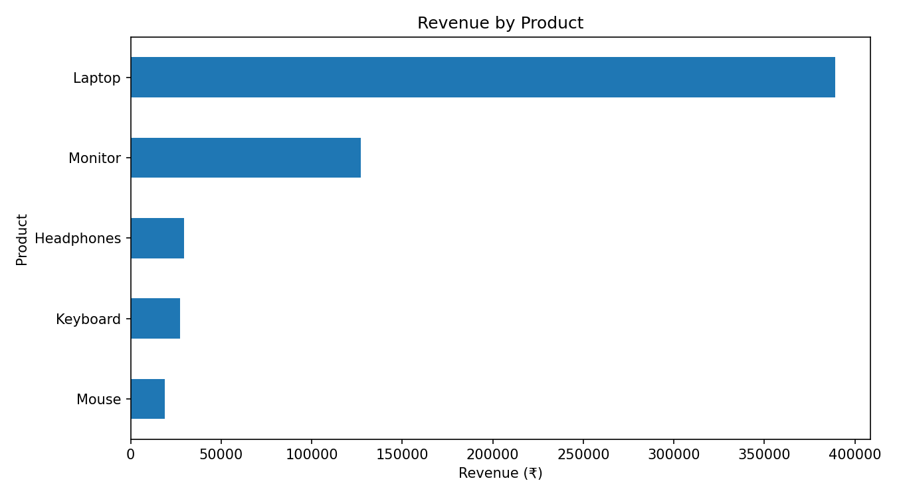
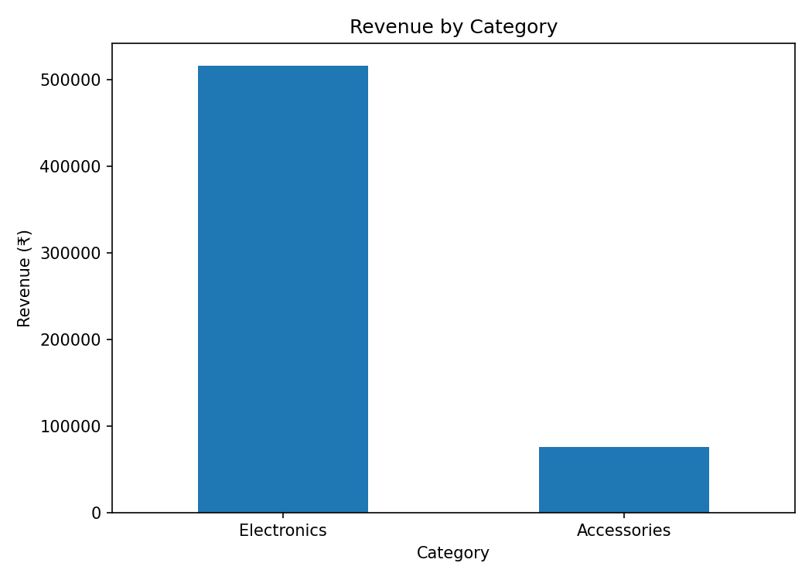

# Sales Data Analysis Using Python

A Python-based sales analytics project that explores revenue trends, product performance, and category-level sales using a fictional demonstration dataset.

## Project Overview

This project demonstrates a basic data analysis workflow: loading transaction data, validating and cleaning records, calculating revenue, summarizing performance, and visualizing results.

The dataset is fictional and is intended for learning and portfolio demonstration. It does not represent actual company sales or client results.

## Objectives

- Calculate total revenue, unique orders, units sold, and average revenue per order.
- Analyze revenue by month.
- Compare revenue across products and categories.
- Check for missing values and invalid records.
- Generate reusable CSV reports and charts.

## Technology Stack

- **Python** — analysis and data processing
- **Pandas** — data cleaning, grouping, and calculations
- **Matplotlib** — charts and visualization
- **CSV** — input dataset and exported reports

## Repository Structure

```text
sales-data-analysis/
├── README.md
├── sales_analysis.py
├── sales_data.csv
├── sales_analysis.csv
├── product_sales.csv
├── monthly_sales.csv
├── monthly_revenue.png
├── product_revenue.png
└── category_revenue.png
```

## Dataset

The sample dataset contains 20 fictional order records with these fields:

| Column | Description |
|---|---|
| `order_id` | Unique order identifier |
| `order_date` | Date of the order |
| `product` | Product purchased |
| `category` | Product category |
| `quantity` | Number of units sold |
| `unit_price` | Price per unit in Indian rupees |

Revenue is calculated as:

`Revenue = Quantity × Unit Price`

## Methodology

1. Load the CSV dataset using Pandas.
2. Validate required columns and convert dates and numeric fields.
3. Remove records with missing required values and exclude negative quantities or prices.
4. Calculate revenue for each order.
5. Aggregate revenue by month, product, and category.
6. Calculate summary metrics and export CSV reports.
7. Generate three visualizations.

## Visualizations

### Monthly Sales Revenue



### Revenue by Product



### Revenue by Category



## Key Metrics

The script calculates:

- Total revenue
- Number of unique orders
- Total units sold
- Average revenue per order
- Revenue by product
- Revenue by category
- Monthly revenue

The exact figures are calculated from the included fictional dataset when the script runs.

## How to Run

### 1. Install Python

Install Python 3.10 or later.

### 2. Install dependencies

```bash
pip install pandas matplotlib
```

### 3. Clone the repository

```bash
git clone https://github.com/Taarushi-byte/sales-data-analysis.git
cd sales-data-analysis
```

### 4. Run the analysis

```bash
python sales_analysis.py
```

The script prints the summary report and creates or updates the CSV reports and chart images in the project folder.

## Limitations

- The dataset is small and fictional.
- The results are illustrative, not business forecasts.
- The analysis does not account for costs, discounts, returns, or profit margins.
- The sample covers a limited date range.

## Future Improvements

- Add customer-level analysis.
- Include profit and margin calculations.
- Build an interactive dashboard.
- Add automated data-quality tests.
- Expand the dataset and compare seasonal patterns.

## Author

**Tarushi Mahesh**

- GitHub: https://github.com/Taarushi-byte
- LinkedIn: https://www.linkedin.com/in/tarushi-m-080983260/
- Email: tarushimahesh@gmail.com
